

# Your CAD repo, as a showcase. { .sk-hero__line }

Sklent turns the 3D designs in a Git repo into turntable videos, stills,
drawing sheets and marketplace listing packs, on your own server. Point it at a repo on GitHub or
Forgejo (a self-hosted Git forge) and it renders every STEP, STL and 3MF file in it, plus designs
made in <a href="https://github.com/tangency-labs/solidcraft">SolidCraft</a>, an open-source parametric CAD app. AI agents like Claude
can run it too, over MCP, the protocol they use to call tools.

[Install](install.md){ .md-button .md-button--primary } [Connect an agent](mcp.md){ .md-button }

{ .sk-shot }

01 · Input<strong>Point it at a repo</strong>

An account, repo, folder, file, branch, tag or pull request on GitHub or Forgejo. Nothing is cloned, and a re-scan renders only the files that changed.

02 · Output<strong>Every output a maker publishes</strong>

Turntable movies, reels, Discord clips, GIFs and stills in shaded and x-ray, plus spec cards, engineering sheets, parts lists, print file packs and marketplace listing packs.

03 · Runs on<strong>Your own server</strong>

One Docker container, GPU or software rendering. Sklent works on its own and keeps every set on its own disk. If you also run <a href="https://kist.pictures">Kist</a>, a self-hosted library for the images and files you collect, it files each set there, tagged and versioned.

<b>6 × 2</b>core outputs, shaded and x-ray

<b>1024 px</b>quick-check still, made first

<b>3840×2160</b>high-res still

<b>46</b>MCP tools, 24 read-only

<b>5</b>marketplace listing packs

## See it move

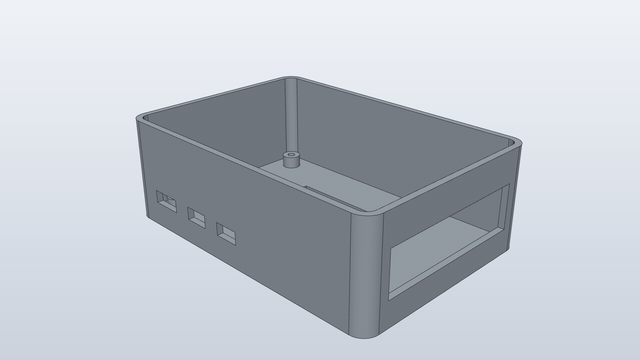{ .sk-shot .sk-gif }

Every design gets the same orbit, fitted so its bounding box stays in frame at every angle, in
**cool grey** or **white**: never in the design's own colours.

## Outputs

Real outputs of Sklent 0.2.1 from public designs in
[tangency-labs/solidcraft](credits.md). The full list, with every setting and its default, is
in [Outputs and settings](outputs.md).

<figure markdown>

<figcaption><b>Turntable</b> · 1080p MP4 and a 640 px GIF, shaded and x-ray</figcaption>
</figure>
<figure markdown>
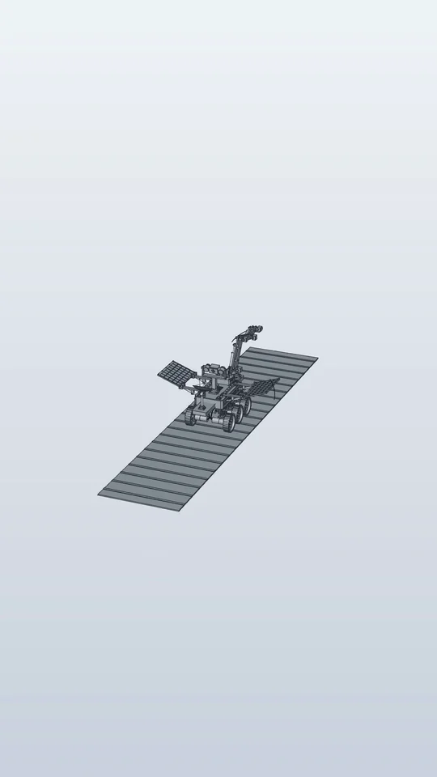
<figcaption><b>Reel</b> · 1080×1920 for Instagram reels and stories (a frame)</figcaption>
</figure>
<figure markdown>

Exploded still and animation: needs two or more components, and none of the small example designs has them, so there's no picture here yet.

<figcaption><b>Exploded</b> · <code>views_exploded</code>, off by default</figcaption>
</figure>
<figure markdown>
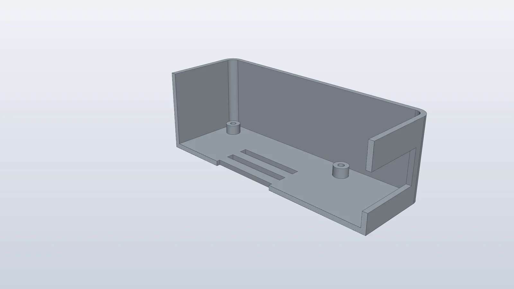
<figcaption><b>Section</b> · a cut through the centre with filled caps</figcaption>
</figure>
<figure markdown>
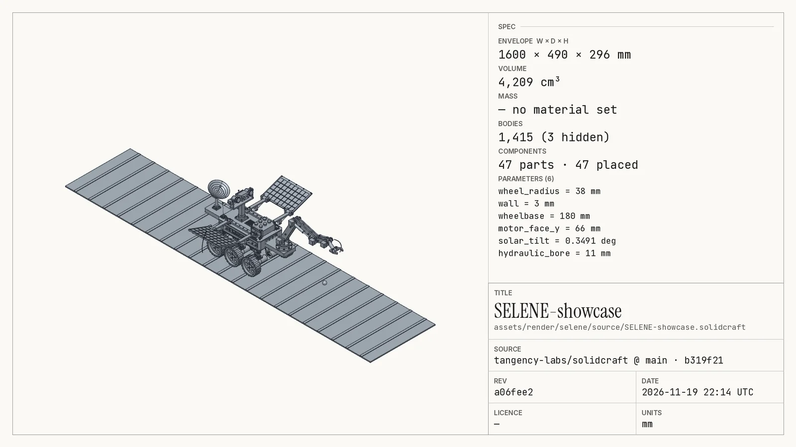
<figcaption><b>Spec card</b> · 2048×1152, from <code>spec.json</code></figcaption>
</figure>
<figure markdown>
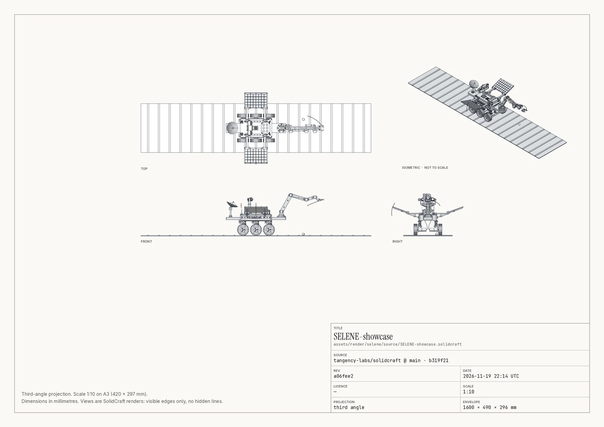
<figcaption><b>Engineering sheet</b> · A3 views sheet, PNG and PDF</figcaption>
</figure>
<figure markdown>
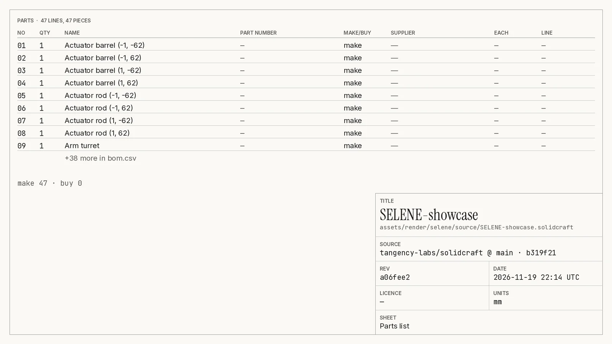
<figcaption><b>BOM</b> · CSV, JSON and a parts sheet</figcaption>
</figure>
<figure markdown>
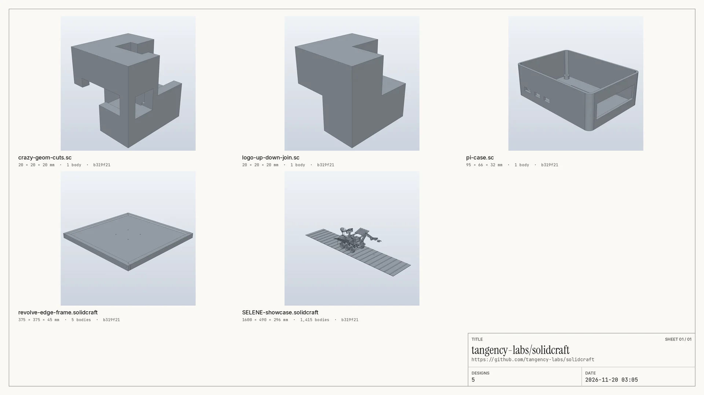
<figcaption><b>Contact sheet</b> · every design of a source, PNG pages and a PDF</figcaption>
</figure>

## The drawing sheet

Click a tile and the design opens as a drawing sheet: the file at its true pixel size between
dimension lines, a numbered schedule of every file, and a title block with the source, commit,
revision, palette and envelope. The same window holds revisions, specs and the publish pages.

=== "Dark"
    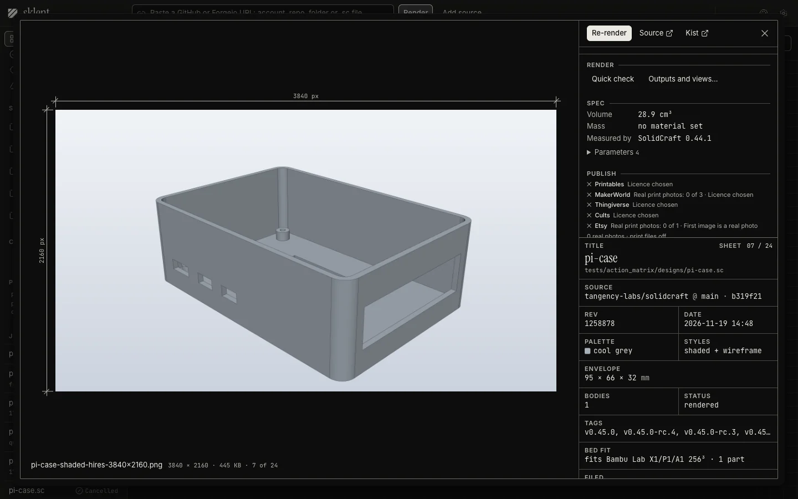{ .sk-shot }
=== "Grid, gallery grey"
    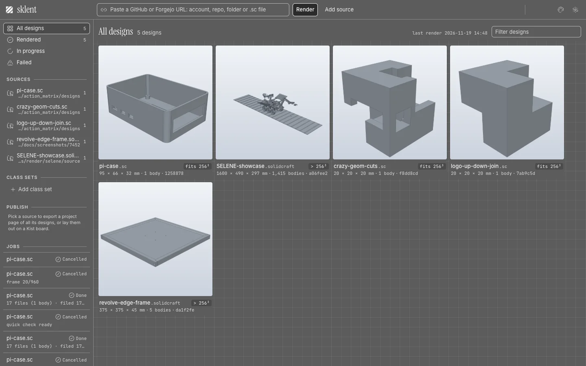{ .sk-shot }
=== "Grid, light"
    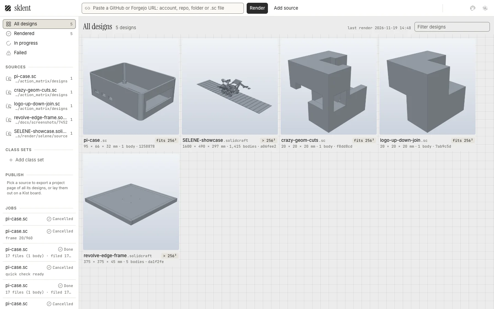{ .sk-shot }
=== "Grid, dark"
    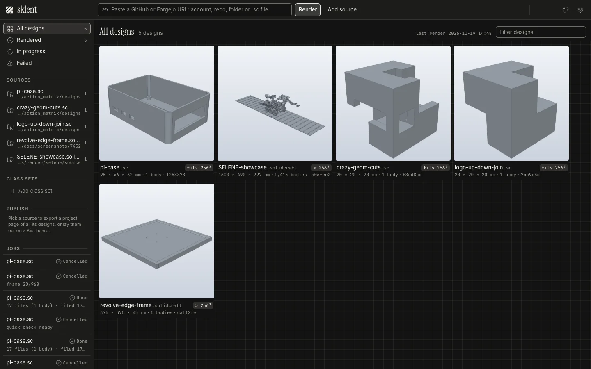{ .sk-shot }

It works on a phone too: the menu opens filters, sources and jobs.

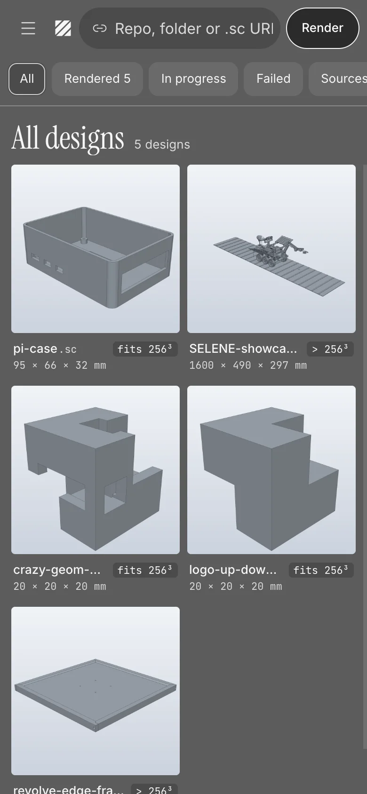
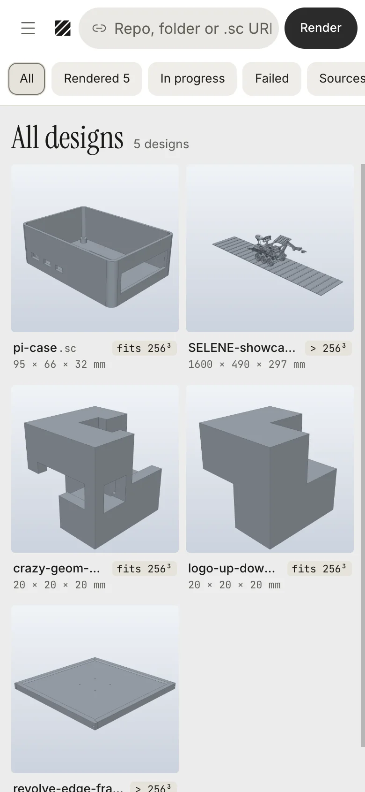
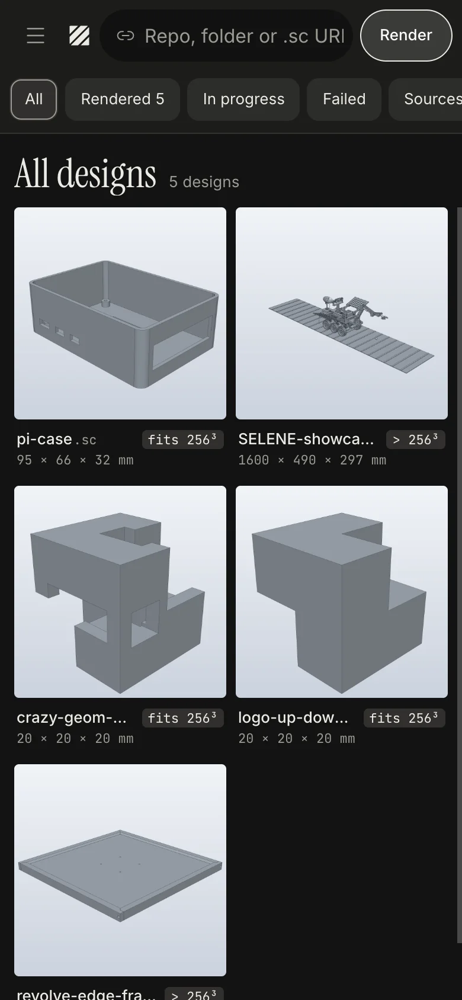

## A sibling of Kist

Sklent shares its [design system](https://kist.pictures/brand/) with [Kist](https://kist.pictures), so the two apps look like one
suite. You don't need [Kist](https://kist.pictures) to use Sklent. If you run it, Sklent files every render set into
a folder there, tagged by repo, design, style, format and commit, with each new version stacked
on the last. Without it, Sklent keeps the sets on its own disk and does everything else the same.
More in [Working with Kist](kist.md).
