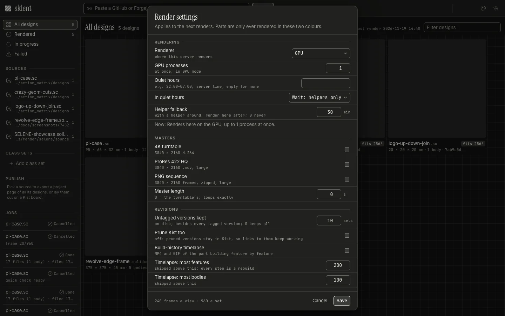

# Install

Sklent is one Docker container: the web app, the API, the MCP endpoint and a render worker,
with SolidCraft, ffmpeg and Mesa inside. It needs:

- **Docker** with Compose, on an **x86-64 Linux** host (the image pins SolidCraft's
  `linux-x86_64` build, 0.44.1, checked by SHA-256).
- **A GPU, for speed** (optional): an Intel or AMD GPU visible as `/dev/dri`, used through Mesa
  Vulkan. Without one, SolidCraft renders in software: the same pictures, slower.
- **Memory** to match your designs: each SolidCraft process loads the whole design (a
  2,000-body assembly takes about 6.7 GB). Small parts are fine on a few GB.

## 1. Get it and write `.env`

```bash
git clone https://github.com/jdoscher/sklent.git
cd sklent
cp .env.example .env
openssl rand -hex 24          # paste this as SK_TOKEN
```

The settings that matter on day one:

| variable | default | |
|---|---|---|
| `SK_TOKEN` | | **Required.** Admin token for the UI, API and MCP (16+ characters) |
| `SK_PORT` | `8090` | Host port for the UI, API and MCP |
| `SK_DATA` | `./data` | The database and local render sets |
| `SK_KIST_URL`, `SK_KIST_TOKEN` | | A [Kist](kist.md) to file sets into; leave the URL empty to keep renders local |
| `SK_GITHUB_TOKEN` | | Private repos, and a higher API limit (GitHub allows 60 anonymous API calls an hour) |
| `SK_FORGEJO_URL`, `SK_FORGEJO_TOKEN` | | Your Forgejo; its token is only ever sent to that host |
| `SK_RENDERER` | `gpu` | `gpu`, `software` (Mesa lavapipe on the CPU) or `off` (helpers only) |
| `SK_RENDER_GID` | `992` | The group that owns `/dev/dri/renderD128` (`getent group render`) |
| `TZ` | `UTC` | The time zone of [quiet hours](helpers.md#this-servers-gpu) |

Every variable, including the scan interval and the process cap, is in the README's
[Configuration](https://github.com/jdoscher/sklent#configuration) table. Render and feature
settings live in the app, not in `.env`: see [Outputs and settings](outputs.md).

## 2. GPU or software

=== "GPU (Intel or AMD)"
    `docker-compose.yml` passes `/dev/dri` in and adds the render group. Check the group id:

    ```bash
    getent group render      # render:x:992:  ->  SK_RENDER_GID=992
    ```

    At most `render_gpu_processes` SolidCraft processes (default 1) use the GPU at once, so a
    GPU shared with other work stays usable. Raise it in **Settings → Rendering** if the GPU
    is Sklent's alone.

=== "Software (no GPU)"
    Delete the `devices:` and `group_add:` keys from `docker-compose.yml` and set
    `SK_RENDERER=software` in `.env`. SolidCraft then runs on Mesa's lavapipe and never opens
    a GPU. Big designs can fan their frames out to `SK_RENDER_PROCESSES` processes (default 4),
    capped by free memory.

You can switch at any time in **Settings → Rendering**, which overrides `SK_RENDERER`, or hand
the rendering to another machine: [Render helpers](helpers.md).

## 3. Start it

```bash
docker compose up -d --build
docker compose logs -f app       # wait for the server to start
```

The image build downloads SolidCraft and Ubuntu's Mesa and ffmpeg, so the first build takes a
few minutes. The container's health check is `GET /api/health`.

## 4. First run

1. Open `http://<host>:8090` and paste `SK_TOKEN` into the token gate. The browser keeps it.
2. Paste a URL into the top bar and press **Render**. Try a public repo first, for example
   `https://github.com/tangency-labs/solidcraft/blob/main/tests/action_matrix/designs/pi-case.sc`.
3. The tile shows a **quick check** still within seconds of the design loading, then the
   full set as it finishes. Hover a tile to play its turntable; click it for the drawing sheet.

What a URL can point at (an account, a folder, a branch, a pull request, a class set) is in
[Inputs and access](inputs.md).

{ .sk-shot }

## Rendering without the app

A design that is only on disk renders with the CLI, with no database and no Kist:

```bash
docker compose run --rm app sklent render /data/some.sc /data/out --palette white
docker compose run --rm app sklent render /data/robot.step /data/out \
  --settings '{"styles": ["shaded"], "specs_assembly": true}'
docker compose run --rm app sklent render /data/arm.sc /data/out --outputs 1080p,gif --highlight 'Arm*'
```

`sklent render` applies the `.sklent.yaml` files above the design (up to the git root;
`--config PATH` names one, `--config none` skips them), then `--palette` / `--seconds`, then
`--settings`, `--outputs` (`''` = quick check only) and `--highlight`. Add
`--renderer software` to keep it off the GPU.

## Upgrading

Pull the new version and rebuild: `git pull && docker compose up -d --build`. The database
gains new columns and tables on start; back up `data/sklent.db` first. Each release's notes in
the [changelog](https://github.com/jdoscher/sklent/blob/main/CHANGELOG.md) say what changes.
