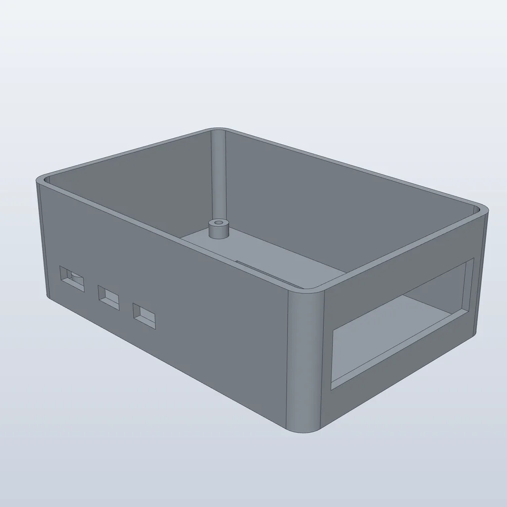
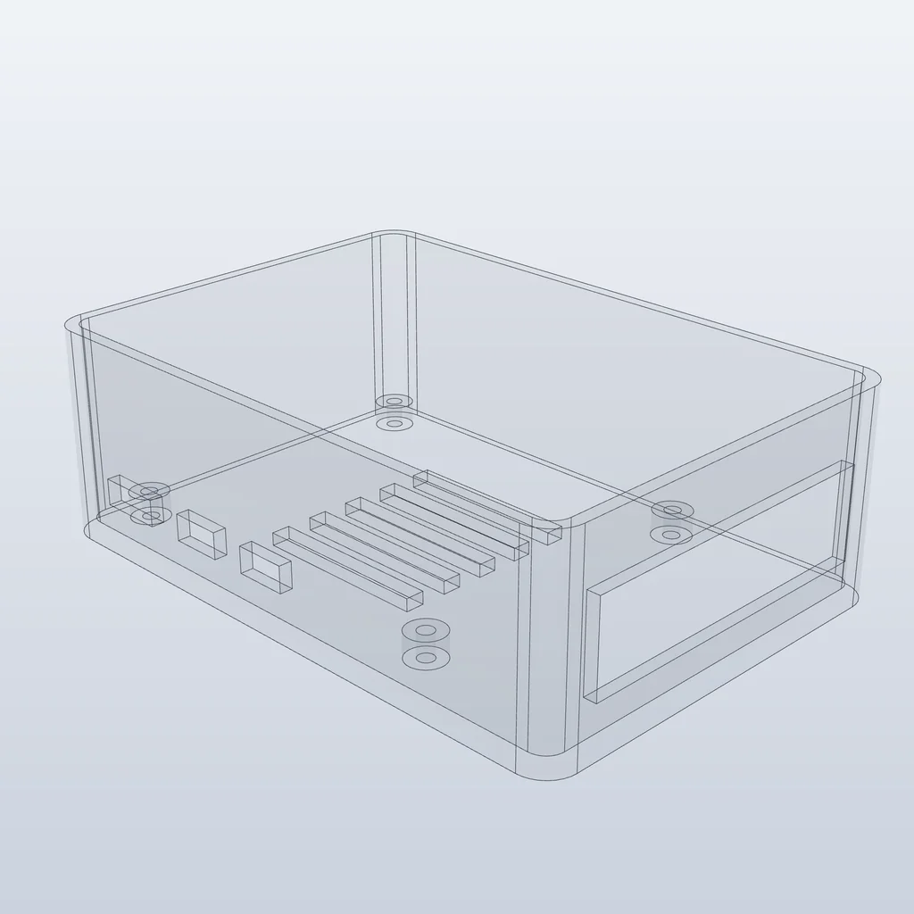
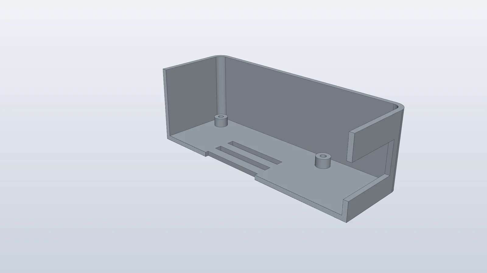
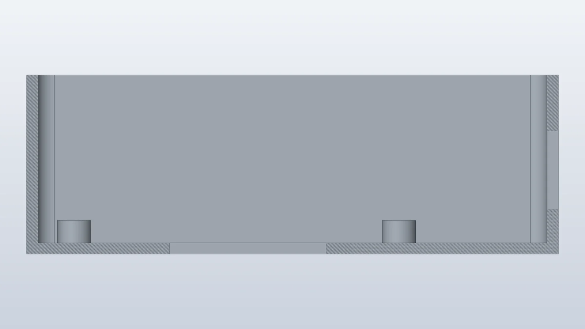
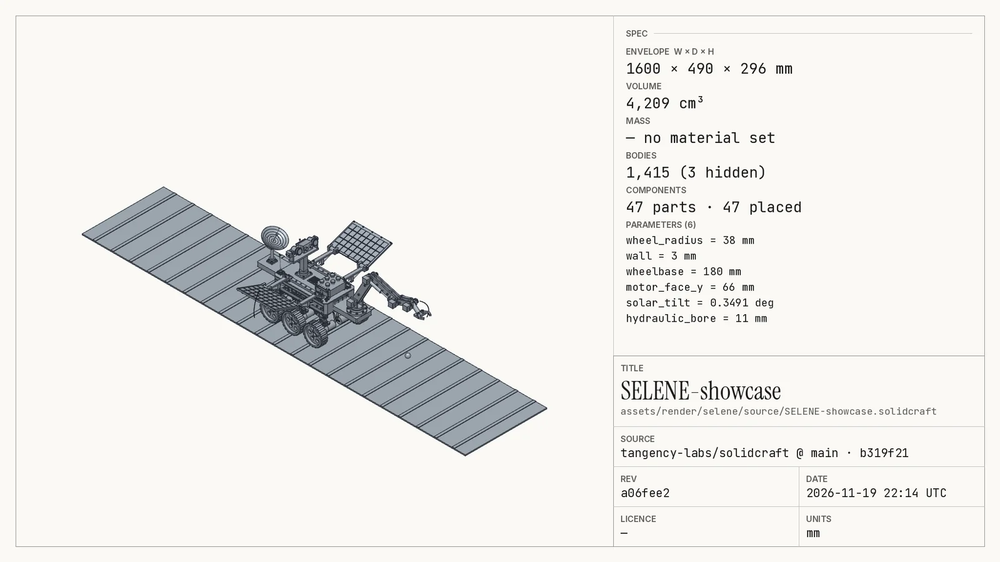
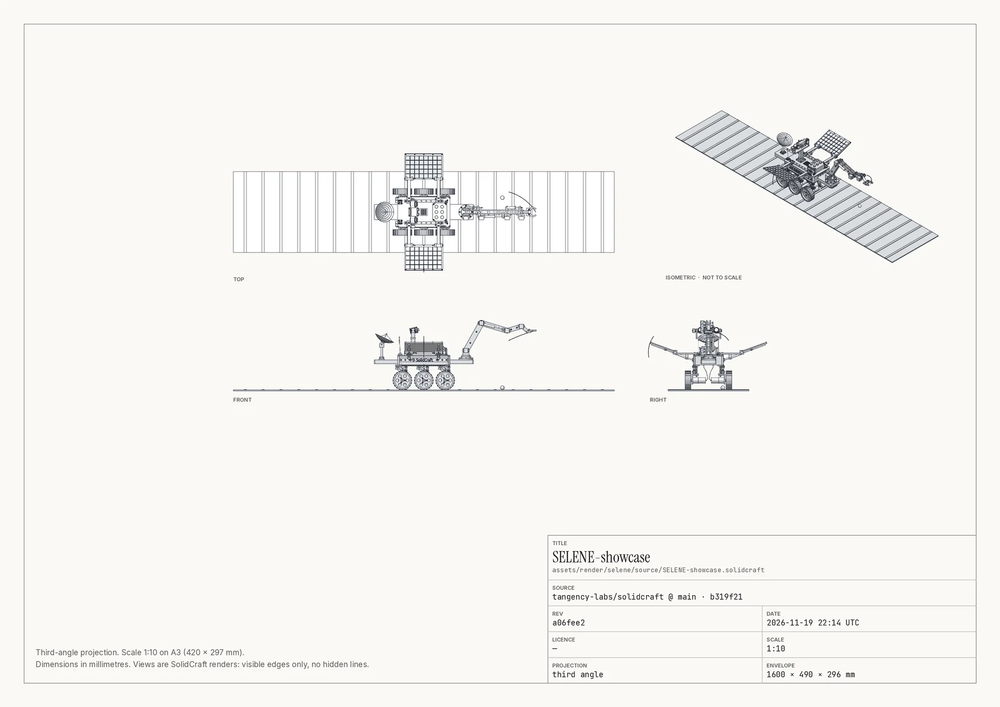
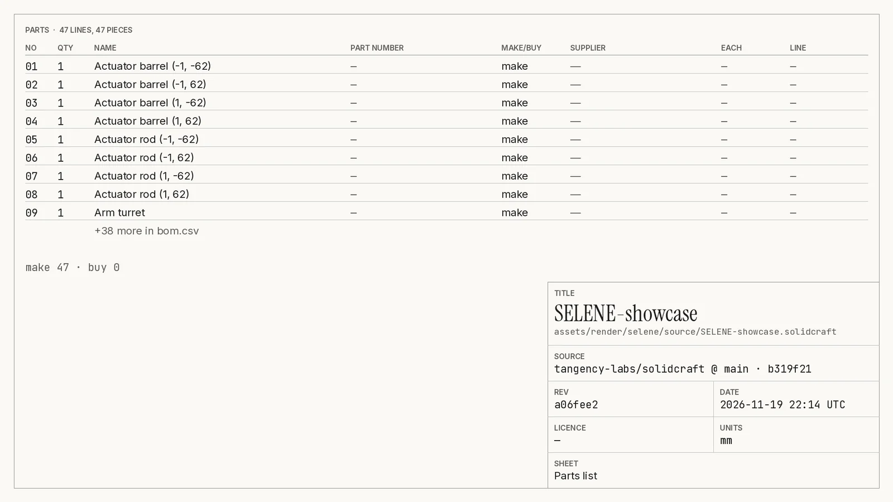
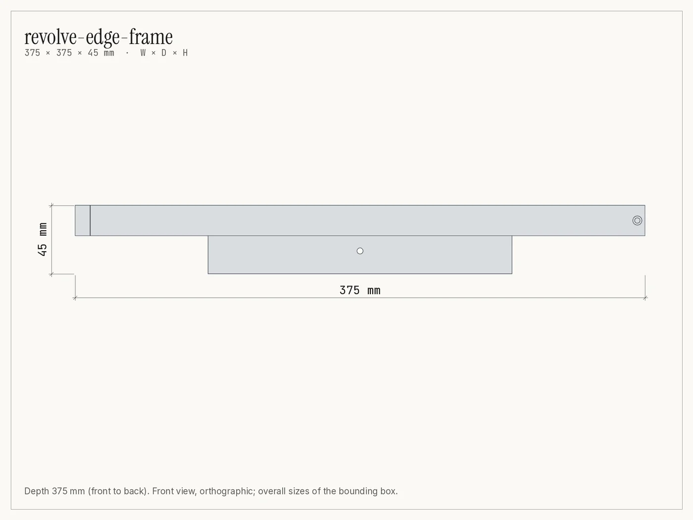
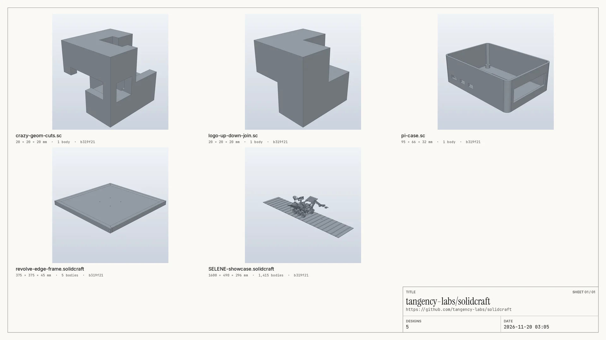

# Outputs and settings

Every render makes one **render set** per version of a design: the files below, a
`report.json` (frame time, process count, per-step timings, where it was rendered) and a
`spec.json`. With [Kist](kist.md) on, every file is also filed into the design's Kist folder,
tagged `format:<variant>`.

Settings live in the app: **Settings** in the UI, `GET/PUT /api/settings`, the MCP tools
`set_render_settings` and `set_views_settings`, and per repo in `.sklent.yaml`
(`settings:`, see [Inputs](inputs.md#sklentyaml)). Most can also be chosen for one render from
the sheet's **Outputs and views…**.

## Core outputs

For each design, in a **shaded** and a **wireframe** (x-ray) style:

| file | size | for |
|---|---|---|
| `<design>-<style>-1080p.mp4` | 1920×1080 | turntable movie |
| `<design>-<style>-reel-1080x1920.mp4` | 1080×1920 | Instagram reels and stories |
| `<design>-<style>-discord-640p.mp4` | 1138×640, under 10 MB | Discord |
| `<design>-<style>.gif` | 640 px wide | anywhere |
| `<design>-<style>-social-2048.png` | 2048×2048 | social posts |
| `<design>-<style>-hires-3840x2160.png` | 3840×2160 | the web |

Every render starts with a **quick check**: one shaded iso still (`<design>-preview.png`,
1024×1024), made seconds after the design loads and shown on its tile while the rest renders.
`outputs` picks which of the six files a render makes; none at all is a quick check on its own.
A quick check of a design that already has a set is kept beside it (`<design>/quick/`) and
never replaces the full set.

Parts are always rendered in **cool grey** or **white**, never in the design's own colours:
every body is repainted before rendering, and a colour guard greys out any pixel that still
carries colour (per-face paint, imported STEP colours).

<div class="sk-gallery" markdown>
<figure markdown>

<figcaption><b>Shaded</b> · <code>pi-case-shaded-social-2048.png</code></figcaption>
</figure>
<figure markdown>

<figcaption><b>Wireframe (x-ray)</b> · <code>pi-case-wireframe-social-2048.png</code></figcaption>
</figure>
</div>

The wireframe style is an x-ray (see-through bodies with every edge): SolidCraft's headless
renderer ignores `view.visual_style`.

### Render settings

| setting | default | |
|---|---|---|
| `palette` | `cool-grey` | `cool-grey` or `white` |
| `seconds`, `fps`, `pitch_deg` | `8`, `30`, `24` | Turntable length, frame rate, camera pitch |
| `hires_width` × `hires_height`, `social_size`, `gif_width`, `gif_fps` | `3840×2160`, `2048`, `640`, `15` | Still and GIF sizes |
| `styles` | `shaded, wireframe` | Which looks to render |
| `outputs` | all six | Which of `1080p`, `reel`, `discord`, `gif`, `social`, `hires` |

## Views and render modes

Off unless noted. Each is a setting (`views_*`) and can also be turned on for one render.
Extra files land in the set, in Kist (`format:<variant>`) and on the design's sheet.

| variant | what | setting (default) |
|---|---|---|
| `preset-<shot>` | Shot presets: `half-orbit` (eases onto the iso angle), `push-in`, `top-to-iso`, `low-angle`; eased, every frame fitted to the part | `views_shot_half_orbit`, `…_push_in`, `…_top_to_iso`, `…_low_angle` (off); `views_shot_seconds` (6) |
| `master-4k`, `prores`, `frames-zip` | Edit-ready masters: 4K H.264, ProRes 422 HQ, the PNG sequence; an exact loop, up to 60 s | `views_master_4k`, `views_master_prores`, `views_master_zip` (off); `views_master_seconds` (0 = the turntable's length) |
| `exploded`, `explode-anim` | The design's first saved exploded view, else SolidCraft's automatic one, as a 4K still and an MP4 + GIF that comes apart and goes back together. Needs two or more components | `views_exploded` (off), `views_explode_scale` (1) |
| `section` | A cut through the centre containing the longest axis, with filled, hatched caps: a 3/4 view and a face-on orthographic one | `views_section` (off) |
| `config-<n>`, `config-lineup` | One still per configuration row at one scale, and a lineup with the row names | `views_configs` (on; designs with 2+ rows), `views_configs_max` (8) |
| `motion-<study>` | Each motion study played, MP4 + GIF | `views_motion` (on; designs with studies), `views_motion_max` (6) |
| `highlight`, `highlight-turntable` | "My part": the named bodies solid, the rest x-ray | per design: **My part** on the sheet, else `highlight:` in `.sklent.yaml` |
| `transparent` | RGBA stills at the social and high-res sizes | `views_transparent` (off) |
| `hero` | A path-traced studio still with alpha; skipped, with the reason, when the scene is too big | `views_hero` (off), `views_hero_timeout` (900 s) |
| `plate` | Every distinct part laid on its thinnest side (a guess, labelled so), top-down on a 10 mm grid, `×n` for repeats | `views_plate` (off) |

<div class="sk-gallery" markdown>
<figure markdown>

<figcaption><b>Section</b> · <code>pi-case-section-3840x2160.png</code></figcaption>
</figure>
<figure markdown>

<figcaption><b>Section, orthographic</b> · <code>pi-case-section-ortho-3840x2160.png</code></figcaption>
</figure>
</div>

A **bed-fit badge** on each tile (`fits 256³`, or `> 256³`) checks every part's bounding box,
in any axis-aligned orientation, against a named bed: `views_bed` (default
`Bambu Lab X1/P1/A1`) from `views_beds` (default `Bambu Lab A1 mini 180x180x180; Bambu Lab
X1/P1/A1 256x256x256; Prusa MK4 250x210x220; Prusa Core One 250x220x270`); `views_bedfit`
(on) shows it. Views that can't apply (one component, no studies, a scene over the renderer's
budget) are skipped, and the sheet's **Views** section says why.

## Specs and sheets

Drafting sheets from the same open design. Parts stay grey or white, and dimension lines only
appear on orthographic views, where they are true.

| file (variant) | default | what it is |
|---|---|---|
| `spec.json` | always | Envelope, volume, mass (only when a material is known), bodies, components, user parameters, commit, blob, licence |
| `<design>-spec-card.png` (`spec-card`) | on (`specs_card`) | 2048×1152 card: the part, the spec list and a title block |
| `<design>-bom.csv`, `bom.json`, `<design>-bom-sheet.png` (`bom-csv`, `bom-sheet`) | on (`specs_bom`), for assemblies or with a `bom.yaml` | SolidCraft's `assembly.bom` merged with the repo's `bom.yaml` (bought parts: name, qty, supplier, url, price) |
| `<design>-views-sheet.png` / `.pdf` (`views-sheet`, `views-sheet-pdf`) | on (`specs_views`) | A3 sheet: front, top and right views in third-angle projection at one ISO scale, an iso view and a title block. Visible edges only |
| `<design>-dimensions-2048.png` (`dimensions`) | on (`specs_dimensions`) | The front view with overall width and height as ISO 129 dimension lines, depth noted |
| `<design>-assembly-NN.png`, `<design>-assembly.md` (`assembly-N`, `assembly-md`) | off (`specs_assembly`, at most `specs_assembly_max_steps` = 20) | Assemblies: one picture per step and a GitBuilding BuildUp page |

`specs_material` (empty) names a material for mass when `.sklent.yaml` names none;
`specs_bom_file` (`bom.yaml`) is the repo's parts file. A material of SolidCraft's placeholder
"Default" doesn't count.

<div class="sk-gallery" markdown>
<figure markdown>

<figcaption><b>Spec card</b> · SELENE-showcase, 1,415 bodies</figcaption>
</figure>
<figure markdown>

<figcaption><b>Views sheet</b> · third angle, scale 1:10 on A3</figcaption>
</figure>
<figure markdown>

<figcaption><b>Parts sheet</b> · from SolidCraft's <code>assembly.bom</code></figcaption>
</figure>
<figure markdown>

<figcaption><b>Dimensions</b> · ISO 129 lines on the front view</figcaption>
</figure>
</div>

`bom.yaml`:

```yaml
currency: EUR               # optional
parts:                      # or a bare list
  - name: M3x8 socket head cap screw
    qty: 8
    supplier: Example Fasteners
    url: https://example.com/m3x8
    price: 0.12             # each
  - match: Arm              # enrich a model part (by name or part number) instead of adding one
    notes: print in PETG
```

### Contact sheet

Every rendered design of a source on one page (3840×2160 PNG pages of 24 and a PDF), each as
its hero still with mono labels under a title block. Make it from the grid button on a
source's row, `POST /api/sources/{id}/contact-sheet`, or MCP `make_contact_sheet`. With Kist on
it is filed once per version, tagged `format:contact-sheet`.

{ .sk-shot }

## Build-history timelapse

With `revisions_timelapse` on (off by default), each render also makes
`<design>-timelapse-1080p.mp4` and `.gif`: the part building itself feature by feature from a
fixed iso camera. Designs over `revisions_timelapse_max_bodies` (100) bodies or
`revisions_timelapse_max_features` (200) features are skipped, with the reason in
`report.json`. More in [Revisions](revisions.md).

## Publishing settings

Presets, file packs, listing packs, brand and Kist review settings (`outputs_*`) are on
[Publishing](publishing.md#settings). The rendering and helper settings (`render_*`,
`helpers_*`) are on [Render helpers and GPU](helpers.md#settings).
